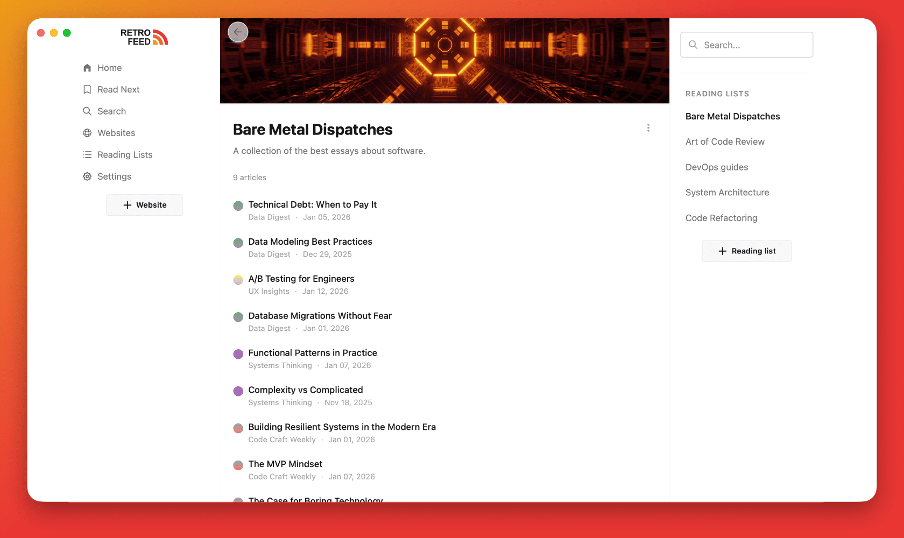

# Retrofeed

> Read the web like a library.

Retrofeed turns blog archives into a personal reading library. Follow blogs like RSS feeds,
rediscover older posts, and collect articles in reading lists. `Retrofeed = Instapaper + RSS + archive`.



- Browse a blog's archive and keep track of what you've read.
- Save articles to **Read Next** and organise them into reading lists.
- Search your library and pick up where you left off.
- Adjust the reading font, size, and theme to suit you.

## Run locally

You'll need **Ruby 4.0.3**, **Node.js and npm**, and a running **PostgreSQL** server
with permission to create databases. Install Chrome or Chromium for
browser-assisted scraping.

From a fresh checkout:

```bash
git clone https://github.com/kepano/defuddle.git tools/defuddle
bin/setup --skip-server
bin/rails db:seed
bin/dev
```

Setup installs dependencies, builds the content extractor, and prepares the
databases. `bin/dev` starts Rails, the CSS watcher, background jobs, and the Node.js
extractor together.

Open [localhost:3006](http://localhost:3006). The development seed creates a local
account: **admin@retrofeed.com** / **password123**.

## How it works

Add a blog URL and Retrofeed finds its archive, follows pagination, and indexes
article titles, links, and dates in the background. Download an article when you
want to read it; the extractor turns its page into clean HTML and Markdown.
Your subscriptions, reading lists, and read/unread progress stay in PostgreSQL,
while live updates bring newly discovered articles into the interface.

## Under the hood

- **Ruby on Rails 8.1 + PostgreSQL** for the application and storage.
- **Hotwire (Turbo + Stimulus)** for navigation, interactions, and live updates.
- **Solid Queue + Solid Cable** for background work and broadcasts.
- **Nokogiri + Ferrum/Chromium** for archive parsing and browser-assisted crawling.
- **Node.js + Defuddle** for article extraction; **CSS + Tailwind** for styling.

Run the Rails suite with `bin/rails test`. For more detail, see the
[crawling and extraction guide](docs/crawling-and-extraction.md) and
[deployment guide](docs/DEPLOY.md).
