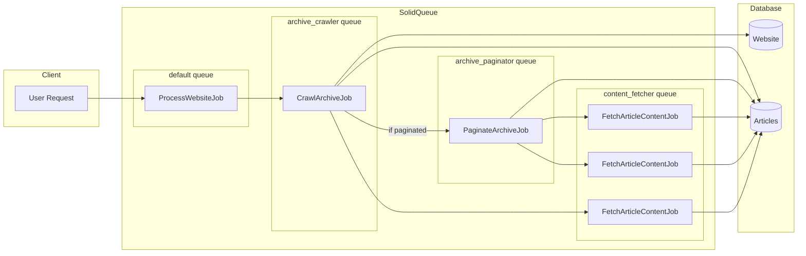

# Website Crawling Pipeline

This document describes the multi-stage pipeline architecture for crawling websites and fetching article content in Retrofeed.

## Overview

The crawling system is split into multiple stages, each running on its own SolidQueue queue:

1. **Archive Crawler** (`archive_crawler` queue) - Discovers articles from archive pages (page 1)
2. **Archive Paginator** (`archive_paginator` queue) - Crawls additional pages for paginated archives
3. **Content Fetcher** (`content_fetcher` queue) - Fetches full content for individual articles

This separation provides:
- **Independent scaling**: Each stage can be scaled based on its workload
- **Fault tolerance**: A failure in content fetching does not affect archive crawling
- **Better observability**: Each stage can be monitored independently
- **Granular retries**: Failed content fetches retry individually without re-crawling the archive
- **Safe pagination**: Paginated crawling runs with hard caps and trap detection

## Architecture



## Jobs

### ProcessWebsiteJob

**Queue**: `default`

The entry point and orchestrator. Validates the URL and delegates to `CrawlArchiveJob`.

```ruby
ProcessWebsiteJob.perform_later(url, user_id)
```

**Arguments**:
- `url` - The archive URL to process
- `user_id` - The user requesting the subscription

**Behavior**:
1. Validates the user exists
2. Validates and normalizes the URL
3. Enqueues `CrawlArchiveJob` with the validated URL

### CrawlArchiveJob

**Queue**: `archive_crawler`

Stage 1 of the pipeline. Crawls the archive page and discovers articles.

```ruby
CrawlArchiveJob.perform_later(url, user_id = nil)
```

**Arguments**:
- `url` - The validated archive URL
- `user_id` - Optional user ID for subscription creation

**Behavior**:
1. Checks if website was recently crawled (skips if within `update_interval`)
2. Fetches and parses the archive page HTML
3. Validates the page contains a valid archive
4. Creates/updates the `Website` record
5. Extracts article metadata from the archive
6. Creates `Article` records (without content)
7. Enqueues `FetchArticleContentJob` for each article needing content
8. Enqueues `PaginateArchiveJob` if pagination is detected
9. Creates subscription if `user_id` provided

**Error Handling**:
- Raises `WebProcessor::InvalidArchiveError` for invalid archives
- Raises `WebProcessor::InvalidArchiveError` on network failures

### PaginateArchiveJob

**Queue**: `archive_paginator`

Stage 1b of the pipeline. Crawls additional pages for paginated archives.

```ruby
PaginateArchiveJob.perform_later(website_id, resume_from_page: nil)
```

**Arguments**:
- `website_id` - The website ID to paginate
- `resume_from_page` - Optional page number to resume from (for interrupted jobs)

**Behavior**:
1. Checks if website is eligible for pagination (has `archive_paginated` flag, not recently completed)
2. Iterates through pages starting from page 2 (page 1 handled by CrawlArchiveJob)
3. Extracts articles from each page
4. Creates `Article` records
5. Enqueues `FetchArticleContentJob` for each article needing content
6. Updates pagination progress (`pagination_last_page_scraped`, `pagination_total_pages_found`)
7. Halts on safety conditions (page/post/duration limits, trap detection)

**Safety Features**:
- **Hard caps**: Max 500 pages, 10,000 posts, 30 minute duration
- **Trap detection**: Circular URLs, duplicate content, page number jumps
- **Robots.txt compliance**: Respects crawl-delay between pages
- **Resumable**: Stores progress for interrupted jobs

**Halt Reasons** (stored in `pagination_halted_reason`):
- `completed` - Reached end of archive naturally
- `page_limit` - Hit max pages limit
- `post_limit` - Hit max posts limit
- `duration_limit` - Hit max duration
- `trap_detected` - Suspected bot trap
- `error` - Network or parsing failure
- `robots_blocked` - robots.txt disallowed further pages

### FetchArticleContentJob

**Queue**: `content_fetcher`

Stage 2 of the pipeline. Fetches full content for a single article.

```ruby
FetchArticleContentJob.perform_later(article_id)
```

**Arguments**:
- `article_id` - The ID of the article to fetch content for

**Behavior**:
1. Loads the article record
2. Checks if content update is needed (skips if recently updated)
3. Extracts content using defuddle (Node.js)
4. Updates article with: `content_html`, `content_md`, `word_count`, `publication_date`

**Retry Configuration**:
- Retries up to 3 times with polynomial backoff
- Discards job if article no longer exists

## Queue Configuration

Located in `config/queue.yml`:

```yaml
workers:
  # Default queue for orchestration jobs
  - queues: [default]
    threads: 3
    processes: 1

  # Archive crawler - lower concurrency
  - queues: [archive_crawler]
    threads: 2
    processes: 1

  # Archive paginator - very low concurrency for polite multi-page scraping
  - queues: [archive_paginator]
    threads: 1
    processes: 1

  # Content fetcher - higher concurrency for parallel fetching
  - queues: [content_fetcher]
    threads: 5
    processes: 1
```

### Scaling Recommendations

- **archive_crawler**: Keep low concurrency (2-3 threads). Each job creates many content fetch jobs.
- **archive_paginator**: Keep very low concurrency (1-2 threads). Respects robots.txt crawl-delay.
- **content_fetcher**: Scale higher (5-10 threads). These are I/O bound (HTTP requests + defuddle).
- In production, consider separate processes for each queue for isolation.

## Flow Example

When a user submits `https://overreacted.io/`:

1. `ProcessWebsiteJob` validates URL, enqueues `CrawlArchiveJob`
2. `CrawlArchiveJob` fetches archive page 1, creates Website, creates 20 Article records
3. `CrawlArchiveJob` detects pagination, enqueues `PaginateArchiveJob`
4. `CrawlArchiveJob` enqueues 20 `FetchArticleContentJob` jobs for page 1 articles
5. `PaginateArchiveJob` crawls pages 2-10, creates 180 more Article records
6. `PaginateArchiveJob` enqueues 180 `FetchArticleContentJob` jobs
7. 5 content fetcher workers process articles in parallel
8. Each article is updated with full content independently

## Update Intervals

Defined in `config/initializers/web_processor.rb`:

- **update_interval** (default: 6 days) - Minimum time between website re-crawls
- **refresh_interval** (default: 30 minutes) - Minimum time between article content refreshes

## Monitoring

### Check Queue Status

```ruby
# Pending jobs per queue
SolidQueue::Job.where(finished_at: nil).group(:queue_name).count

# Failed jobs
SolidQueue::FailedExecution.count

# Jobs by class
SolidQueue::Job.group(:class_name).count
```

### Check Pipeline Progress

```ruby
# Website crawl status
website = Website.find_by(domain: "example.com")
website.last_crawled_at

# Articles with content
website.articles.where.not(content_html: nil).count

# Articles pending content
website.articles.where(content_html: nil).count
```

## Testing

### Unit Tests

- `test/jobs/crawl_archive_job_test.rb` - CrawlArchiveJob unit tests
- `test/jobs/fetch_article_content_job_test.rb` - FetchArticleContentJob unit tests
- `test/jobs/process_website_job_test.rb` - ProcessWebsiteJob unit tests

### Integration Tests

- `test/integration/crawling_pipeline_test.rb` - Full pipeline integration tests

### Running Tests

```bash
# All job tests
bin/rails test test/jobs/

# Integration tests
bin/rails test test/integration/

# Specific test file
bin/rails test test/jobs/crawl_archive_job_test.rb
```

## Troubleshooting

### Articles Missing Content

Check if content fetch jobs failed:

```ruby
article = Article.find(id)
# Find related failed jobs
SolidQueue::FailedExecution.joins(:job).where(
  solid_queue_jobs: { class_name: "FetchArticleContentJob" }
).where("solid_queue_jobs.arguments LIKE ?", "%#{article.id}%")
```

### Website Not Updating

Check the `last_crawled_at` timestamp:

```ruby
website = Website.find_by(domain: "example.com")
website.last_crawled_at
# If within update_interval, crawling is skipped

# Force re-crawl by resetting timestamp
website.update!(last_crawled_at: nil)
```

### Jobs Stuck in Queue

Check for claimed but not completed jobs:

```ruby
SolidQueue::ClaimedExecution.where(
  "created_at < ?", 1.hour.ago
)
```

