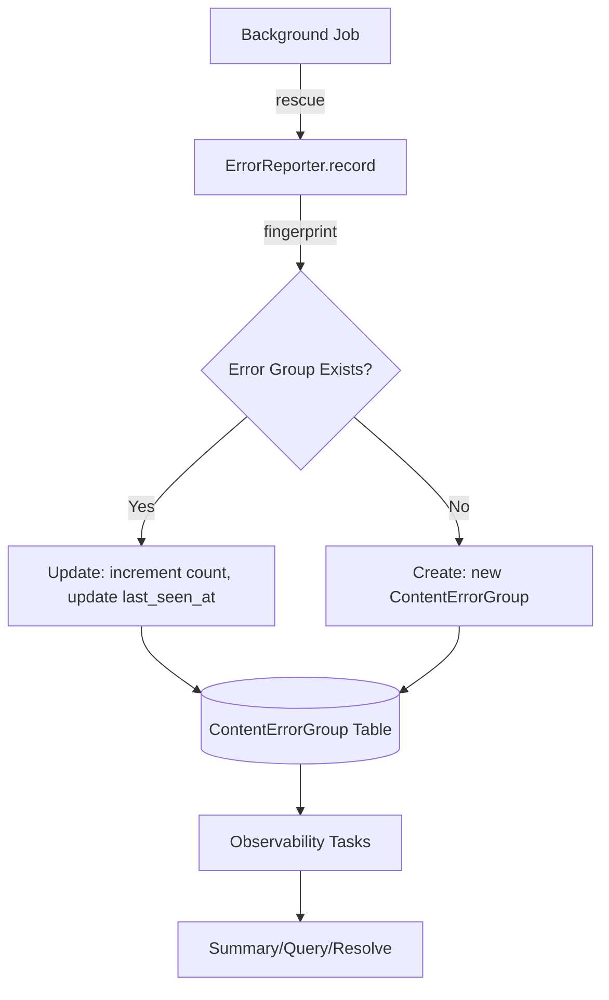

# Error Management and Observability

This document describes the error management implementation and observability capabilities added to Retrofeed's content processing pipeline.

## Context

The content processing pipeline (website crawling, article fetching, content extraction) operates asynchronously through background jobs. When errors occur, they need to be:

1. **Captured** - Not lost in logs or job failures
2. **Grouped** - Similar errors should collapse to avoid noise
3. **Contextualized** - Include relevant metadata (URL, domain, job info, HTTP details)
4. **Queryable** - Enable investigation by website, article, job, or time period
5. **Resolvable** - Mark errors as resolved after fixes

Previously, errors were only logged and visible through SolidQueue's failed job tracking, which doesn't provide grouping, context, or easy querying.

## Decision

Implement a centralized error reporting system with:

- **ErrorReporter service** - Centralized error recording with fingerprinting
- **ContentErrorGroup model** - Database-backed error groups with rich context
- **Observability rake tasks** - Command-line tools for error investigation
- **Job integration** - Error reporting in all pipeline jobs

## Architecture



## Error Grouping and Fingerprinting

Errors are grouped using a deterministic SHA256 fingerprint based on:

- `phase` - Processing phase (e.g., "fetch", "process")
- `operation` - Specific operation (e.g., "article_html_fetch", "website_archive_validate")
- `exception_class` - Exception type (e.g., "WebFetcher::FetchError")
- `message` - Truncated error message (first 200 chars)
- `domain` - Website domain
- `subject` - Polymorphic association (Article or Website)

This ensures:
- **Deduplication**: Same error from multiple job retries collapses into one record
- **Grouping**: Similar errors across different articles/websites remain separate
- **Tracking**: Occurrence count tracks how many times the error happened

## Implementation

### ContentErrorGroup Model

Database table storing error groups with:

**Core Fields**:
- `fingerprint` - SHA256 hash for grouping (unique with subject/domain)
- `phase` - Processing phase ("fetch", "process")
- `operation` - Operation name (e.g., "article_html_fetch")
- `status` - "open", "resolved", or "ignored"
- `severity` - "warn" or "error"
- `message` - Error message (truncated to 2000 chars)
- `occurrences_count` - Number of times this error occurred
- `first_seen_at` / `last_seen_at` - Timestamps

**Context Fields**:
- `subject_type` / `subject_id` - Polymorphic association (Article/Website)
- `domain` - Website domain
- `url` - URL where error occurred
- `exception_class` - Exception class name

**Job Context**:
- `job_class` - ActiveJob class name
- `active_job_id` - Job instance ID
- `queue_name` - Queue name
- `job_arguments` - Serialized job arguments (sanitized)
- `attempt` - Job retry attempt number

**HTTP Context**:
- `http_status` - HTTP status code
- `http_method` - HTTP method
- `content_type` - Response content type
- `response_headers` - Allowlisted headers (content-type, cache-control, retry-after, server)

**Indexes**:
- Unique index on `[fingerprint, subject_type, subject_id, domain]`
- Index on `[status, last_seen_at]` for open error queries
- Index on `[subject_type, subject_id, status, last_seen_at]` for subject queries
- Index on `[domain, status, last_seen_at]` for domain queries

### ErrorReporter Service

Module providing `ErrorReporter.record` method for error reporting:

```ruby
ErrorReporter.record(
  subject: article,           # Optional: Article or Website
  phase: "fetch",             # Required: Processing phase
  operation: "article_html_fetch",  # Required: Operation name
  message: e.message,         # Required: Error message
  exception: e,               # Optional: Exception object
  url: article.url,           # Optional: URL
  domain: website.domain,     # Optional: Domain
  job: self,                  # Optional: ActiveJob instance
  http: {                     # Optional: HTTP context
    http_status: 404,
    http_method: "GET",
    content_type: "text/html",
    headers: response.headers
  },
  severity: "error",          # Optional: "warn" or "error" (default: "error")
  status: "open"              # Optional: "open", "resolved", "ignored" (default: "open")
)
```

**Features**:
- **Fingerprinting**: Generates deterministic hash for grouping
- **Upsert logic**: Finds existing group or creates new one
- **Occurrence tracking**: Increments count for existing groups
- **Safe extraction**: Defensive parsing of URLs, headers, job arguments
- **Header allowlisting**: Only stores safe headers to reduce PII risk
- **Error handling**: Catches and logs errors in error reporting itself

### Job Integration

Error reporting integrated into three pipeline jobs:

#### CrawlArchiveJob
- Records `WebFetcher::FetchError` during archive fetch (phase: "fetch", operation: "website_archive_fetch")
- Records `WebProcessor::InvalidArchiveError` during validation (phase: "process", operation: "website_archive_validate")
- Extracts HTTP context from exceptions

#### FetchArticleContentJob
- Records `WebFetcher::FetchError` during article HTML fetch (phase: "fetch", operation: "article_html_fetch")
- Records `PermanentContentError` during content extraction (phase: "process", operation: "article_defuddle_extract")
- Records `StandardError` for other processing errors
- Associates errors with Article subject

#### ProcessWebsiteJob
- Records `UrlUtils::InvalidUrlError` during URL validation (phase: "process", operation: "website_url_validate")
- Records `StandardError` for other pipeline errors (phase: "process", operation: "website_pipeline")

### WebFetcher Enhancements

`WebFetcher::FetchError` enhanced to carry HTTP context:

```ruby
class FetchError < StandardError
  attr_reader :http_status, :headers, :content_type, :url, :http_method
  
  def initialize(message = nil, http_status: nil, headers: nil, 
                 content_type: nil, url: nil, http_method: "GET")
    # ...
  end
end
```

`WebFetcher::Live` now raises `FetchError` with HTTP context for non-2xx responses.

## Observability

Rake tasks in `lib/tasks/observability.rake` provide command-line tools for error investigation:

### Error Summary

```bash
bin/rails 'observability:errors:summary[30]'
```

Shows:
- Errors grouped by phase/operation/status
- Top domains with errors
- Top subjects (articles/websites) with errors
- Latest 5 errors with details

### List Open Errors

```bash
bin/rails 'observability:errors:open[20]'
```

Lists latest open (unresolved) errors.

### Query by Context

**By Website**:
```bash
bin/rails 'observability:errors:site[example.com]'
bin/rails 'observability:errors:site[123]'
```

**By Article**:
```bash
bin/rails 'observability:errors:article[456]'
bin/rails 'observability:errors:article[https://example.com/article]'
```

**By Job**:
```bash
bin/rails 'observability:errors:job[abcd-1234-efgh]'
```

### View Error Details

```bash
bin/rails 'observability:errors:show[1]'
```

Shows full error information including all context fields.

### Resolve Errors

```bash
bin/rails 'observability:errors:resolve[1]'
```

Marks error as resolved (excluded from open error queries).

## Benefits

1. **Error Visibility**: All pipeline errors captured in one place
2. **Noise Reduction**: Fingerprinting groups similar errors automatically
3. **Rich Context**: HTTP, job, and subject context stored with each error
4. **Easy Investigation**: Query by website, article, job, or time period
5. **Resolution Tracking**: Mark errors as resolved after fixes
6. **Occurrence Tracking**: See how many times an error occurred
7. **Production Ready**: Safe error handling, header allowlisting, defensive parsing

## Trade-offs

1. **Database Growth**: Error groups persist indefinitely (consider cleanup task)
2. **Storage Overhead**: JSON fields for job_arguments and response_headers
3. **Performance**: Database writes on every error (acceptable for error frequency)
4. **Manual Resolution**: Errors must be manually marked as resolved

## Future Enhancements

- Automatic cleanup of old resolved errors
- Error alerting/notifications
- Dashboard UI for error visualization
- Error trends and analytics
- Integration with external error tracking services
